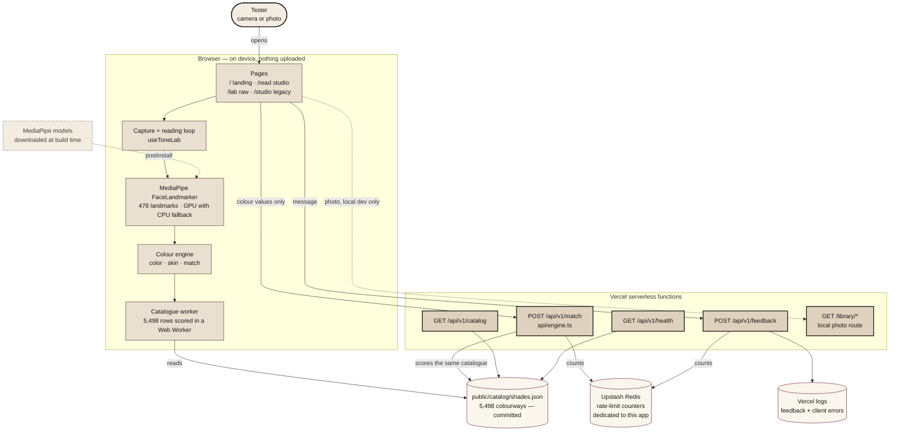
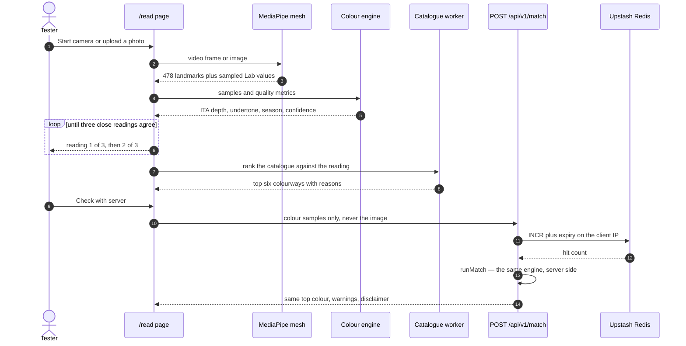
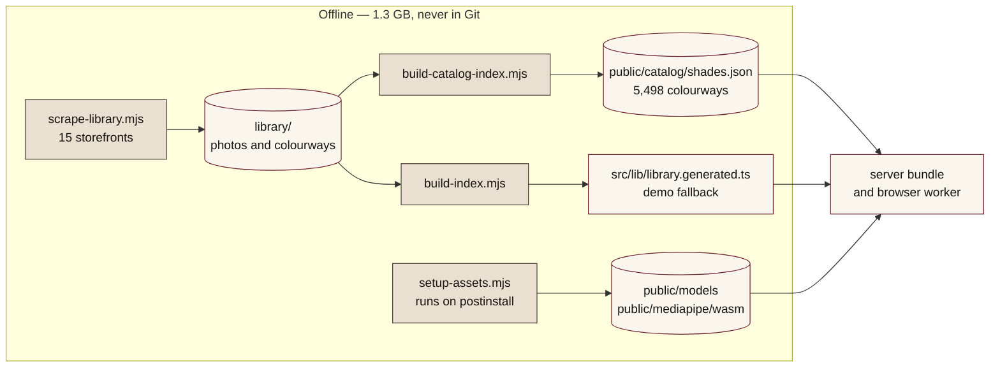

# Architecture

Three diagrams for explaining Auriga: the container view, the reading sequence, and the
offline build pipeline. All Mermaid — paste into GitHub, Notion, `mermaid.live`, or slides.

---

## 1. Container view — what runs where

**The one rule:** frames, video and photos never leave the browser. The only thing that crosses
the network is CIELAB colour samples, and only when the tester presses **Check with server**.

---

## 2. Sequence — one reading, then the server check

---

## 3. Offline pipeline — how the catalogue and models get built

---

## Module map

| Layer | Files | Responsibility |
| --- | --- | --- |
| Pages | `src/app/**/page.tsx` | Landing, `/read`, `/lab`, `/studio`, `/privacy` |
| UI | `src/components/**` | Studio UI, catalogue hook and worker, Lenis scroll, beta banner |
| Capture | `src/components/lab/useToneLab.ts`, `src/lib/face/*` | Camera, photo, 478-point mesh, skin sampling |
| Colour engine | `src/lib/color.ts`, `src/lib/skin.ts`, `src/lib/match.ts` | sRGB to CIELAB, ITA, confidence, ranking, foundations |
| API | `src/app/api/v1/**`, `src/lib/api/*` | Zod contract, orchestration, disclaimer, warnings |
| Server support | `src/lib/server/*` | Catalogue loader, image decode, rate limiting |
| Data | `public/catalog/shades.json`, `src/lib/library.generated.ts` | Scraped index, demo fallback |
| Build | `scripts/*.mjs` | Scrape, index, catalogue, assets, smoke test |
